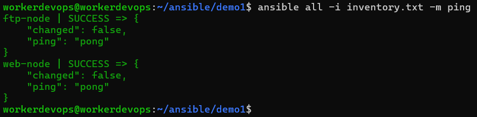
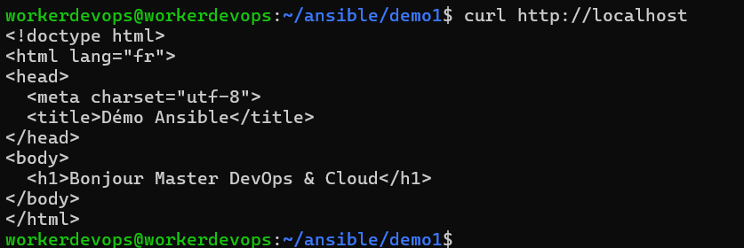
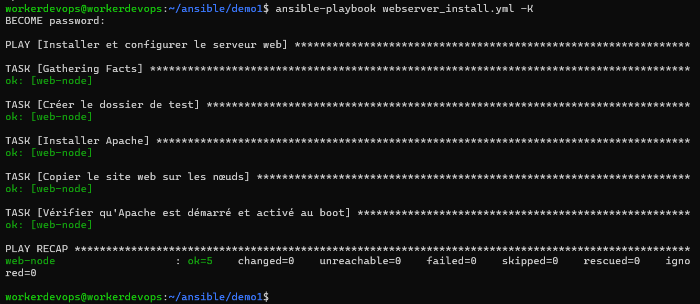
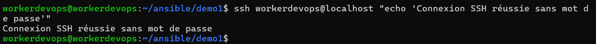
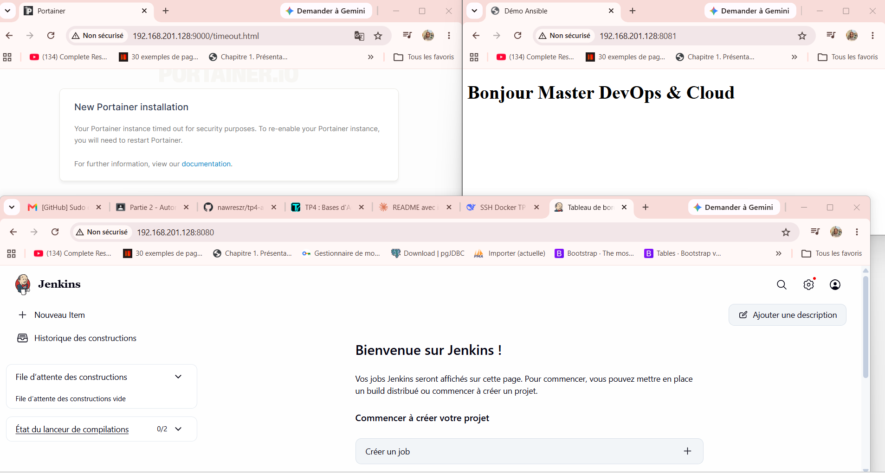
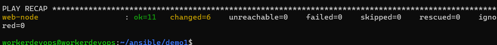

# TP4 – Bases d'Ansible : inventaire, playbooks, clés SSH et rôles

> **Enseignant :** Wahid Hamdi
> **Auteur :** Nawres Zarrouki

Automatisation avec **Ansible** (sans agent, via SSH) : inventaire, `ansible.cfg`, premier playbook idempotent, authentification par clé SSH, installation de Jenkins, Docker, Portainer et d'un conteneur applicatif, puis réorganisation en **rôles**.

## Sommaire

1. [Architecture et vocabulaire](#1-architecture-et-vocabulaire)
2. [Partie 0 : environnement de test et inventaire](#2-partie-0--environnement-de-test-et-inventaire)
3. [Partie 1 : fichier ansible.cfg](#3-partie-1--fichier-ansiblecfg)
4. [Partie 2 : premier playbook](#4-partie-2--premier-playbook)
5. [Partie 3 : authentification par clé SSH](#5-partie-3--authentification-par-clé-ssh)
6. [Partie 4 : Jenkins, Docker, Portainer et conteneur](#6-partie-4--jenkins-docker-portainer-et-conteneur)
7. [Partie 5 : le même playbook avec des rôles](#7-partie-5--le-même-playbook-avec-des-rôles)
8. [Résumé des captures](#8-résumé-des-captures)

---

## 1. Architecture et vocabulaire

```
Nœud de contrôle (Ansible) ──SSH──► Nœud géré 1 (webserver)
                           ──SSH──► Nœud géré 2 (ftpserver)
```

| Terme | Signification |
|---|---|
| Nœud de contrôle | Machine où Ansible est installé et d'où l'on lance `ansible` / `ansible-playbook` |
| Nœud géré | Hôte cible : il n'a besoin que de `sshd` et de Python 3, aucun agent |
| Inventaire | Liste des nœuds gérés, organisés en groupes |
| Module | Unité de travail (`apt`, `copy`, `file`, `service`…) exécutée sur le nœud |
| Playbook | Fichier YAML associant des groupes d'hôtes à des tâches ou des rôles |
| Rôle | Ensemble réutilisable de tâches, handlers, fichiers, templates et variables |

Installation sur le nœud de contrôle (Ubuntu) :

```bash
sudo apt update
sudo apt install -y ansible sshpass
ansible --version
```

Les modules sont **idempotents** : ils décrivent un état souhaité (`state: present`). Un second passage du même playbook doit afficher `changed=0`.

---

## 2. Partie 0 : environnement de test et inventaire

Trois VM Ubuntu Server : 1 nœud de contrôle et 2 nœuds gérés, avec le même compte utilisateur (droits `sudo`) et SSH actif.

```bash
sudo systemctl status ssh
mkdir -p ~/ansible/demo1 && cd ~/ansible/demo1
```

Fichier `inventory.txt` :

```ini
[webserver]
web-node ansible_connection=local ansible_python_interpreter=/usr/bin/python3

[ftpserver]
ftp-node ansible_connection=local ansible_python_interpreter=/usr/bin/python3

[nodes:children]
webserver
ftpserver

[nodes:vars]
ansible_user=workerdevops
```

Vérification de l'inventaire, puis test de connexion (le module `ping` vérifie SSH et Python, ce n'est pas un ping ICMP) :

```bash
ansible-inventory -i inventory.txt --graph
ansible all -i inventory.txt -m ping -k
```

Résultat attendu : `"ping": "pong"` avec `SUCCESS` sur chaque nœud.



---

## 3. Partie 1 : fichier ansible.cfg

Fichier `ansible.cfg` :

```ini
[defaults]
inventory = ./inventory.txt
remote_user = workerdevops
host_key_checking = False
deprecation_warnings = False
```

Ansible lit `./ansible.cfg` avant `~/.ansible.cfg` et `/etc/ansible/ansible.cfg`. Le test de connexion ne demande donc plus `-i` :

```bash
ansible all -m ping -k
ansible-config dump --only-changed
```

> `host_key_checking = False` est réservé au lab.

---

## 4. Partie 2 : premier playbook

Le playbook crée un dossier, installe Apache, copie `index.html` et vérifie que le service est démarré et activé au boot.

Fichier `webserver_install.yml` :

```yaml
---
- name: Installer et configurer le serveur web
  hosts: webserver
  become: true
  gather_facts: true

  tasks:
    - name: Créer le dossier de test
      ansible.builtin.file:
        path: "/home/{{ ansible_user }}/test"
        state: directory
        owner: "{{ ansible_user }}"
        mode: '0755'

    - name: Installer Apache
      ansible.builtin.apt:
        name: apache2
        state: present
        update_cache: true

    - name: Copier le site web sur les nœuds
      ansible.builtin.copy:
        src: index.html
        dest: /var/www/html/index.html
        owner: www-data
        group: www-data
        mode: '0644'

    - name: Vérifier qu'Apache est démarré et activé au boot
      ansible.builtin.service:
        name: apache2
        state: started
        enabled: true
```

Fichier `index.html` :

```html
<!doctype html>
<html lang="fr">
<head>
  <meta charset="utf-8">
  <title>Démo Ansible</title>
</head>
<body>
  <h1>Bonjour Master DevOps & Cloud</h1>
</body>
</html>
```

Vérification de la syntaxe, essai à blanc, exécution :

```bash
ansible-playbook webserver_install.yml --syntax-check
ansible-playbook webserver_install.yml -k -K --check --diff
ansible-playbook webserver_install.yml -k -K
curl http://<IP-DU-NOEUD-WEB>
```



### Idempotence

Deuxième exécution : toutes les tâches sont déjà dans l'état souhaité, le `PLAY RECAP` affiche `changed=0`.



---

## 5. Partie 3 : authentification par clé SSH

```bash
ssh-keygen -t ed25519 -C "ansible-control"
ssh-copy-id <utilisateur>@<IP-NOEUD-1>
ssh-copy-id <utilisateur>@<IP-NOEUD-2>
ansible-playbook webserver_install.yml -K
```

Le mot de passe SSH n'est plus demandé, donc `-k` disparaît. `-K` reste nécessaire pour `sudo`.



---

## 6. Partie 4 : Jenkins, Docker, Portainer et conteneur

Image Docker contenant le site web (`index.html`), publiée sur Docker Hub pour être réutilisée au TP5.

Fichier `Dockerfile` :

```dockerfile
FROM nginx:alpine
COPY index.html /usr/share/nginx/html/index.html
```

```bash
docker build -t <compte-dockerhub>/<image>:1.0 .
docker login
docker push <compte-dockerhub>/<image>:1.0
```

Le playbook installe Jenkins, Docker et Portainer, puis crée le conteneur applicatif avec Docker Compose (port web exposé).

Fichier `docker-compose.yml` :

```yaml
version: '3.8'
services:
  jenkins:
    image: jenkins/jenkins:lts
    ports:
      - "8080:8080"
      - "50000:50000"
    volumes:
      - jenkins_home:/var/jenkins_home
    restart: unless-stopped

  portainer:
    image: portainer/portainer-ce:latest
    ports:
      - "9000:9000"
    volumes:
      - /var/run/docker.sock:/var/run/docker.sock
      - portainer_data:/data
    restart: unless-stopped

  web:
    build: .
    ports:
      - "8081:80"
    restart: unless-stopped

volumes:
  jenkins_home:
  portainer_data:
```

Accès aux services depuis le navigateur : Jenkins (`:8080`), Portainer (`:9000` ou `:9443`) et le conteneur web.



---

## 7. Partie 5 : le même playbook avec des rôles

Le playbook utilise trois rôles : `jenkins_install`, `docker_portainer_install` et `container_deployment`.

```bash
mkdir -p roles
ansible-galaxy role init roles/jenkins_install
```

Le squelette généré contient `defaults/`, `files/`, `handlers/`, `meta/`, `tasks/`, `templates/`, `tests/` et `vars/`. Seul `tasks/main.yml` est obligatoire.

#### Rôle `container_deployment`

Fichier `roles/container_deployment/tasks/main.yml` :

```yaml
---
- name: Créer le répertoire de l'application
  ansible.builtin.file:
    path: /opt/myapp
    state: directory
    mode: '0755'

- name: Copier les fichiers de l'application
  ansible.builtin.copy:
    src: "{{ item }}"
    dest: /opt/myapp/
  loop:
    - Dockerfile
    - index.html

- name: Construire l'image web
  community.docker.docker_image:
    name: tp4-web
    source: build
    build:
      path: /opt/myapp
    state: present

- name: Lancer le conteneur web
  community.docker.docker_container:
    name: web
    image: tp4-web
    state: started
    restart_policy: unless-stopped
    ports:
      - "8081:80"
```

#### Rôle `docker_portainer_install`

Fichier `roles/docker_portainer_install/tasks/main.yml` :

```yaml
---
- name: Installer Docker
  ansible.builtin.apt:
    name: docker.io
    state: present
    update_cache: true

- name: Installer docker compose v2
  ansible.builtin.apt:
    name: docker-compose-v2
    state: present

- name: Créer le volume Portainer
  community.docker.docker_volume:
    name: portainer_data
    state: present

- name: Lancer Portainer
  community.docker.docker_container:
    name: portainer
    image: portainer/portainer-ce:latest
    state: started
    restart_policy: unless-stopped
    ports:
      - "9000:9000"
    volumes:
      - "/var/run/docker.sock:/var/run/docker.sock"
      - "portainer_data:/data"
```

#### Rôle `jenkins_install`

Fichier `roles/jenkins_install/tasks/main.yml` :

```yaml
---
- name: Créer le volume Jenkins
  community.docker.docker_volume:
    name: jenkins_home
    state: present

- name: Lancer Jenkins
  community.docker.docker_container:
    name: jenkins
    image: jenkins/jenkins:lts
    state: started
    restart_policy: unless-stopped
    ports:
      - "8080:8080"
      - "50000:50000"
    volumes:
      - "jenkins_home:/var/jenkins_home"
```

Le second passage du playbook à base de rôles affiche `changed=0`.



---

## 8. Résumé des captures

| Capture | Contenu |
|---|---|
| `ping-pong.png` | `ansible all -m ping` : SUCCESS / pong sur les 2 nœuds |
| `playbook-run.png` | Premier passage de `webserver_install.yml` et `curl` sur le nœud web |
| `idempotence.png` | Deuxième passage avec `changed=0` |
| `ssh-keys.png` | Exécution sans `-k` après `ssh-copy-id` |
| `containers.png` | Jenkins, Portainer et le conteneur web dans le navigateur |
| `roles-run.png` | Exécution du playbook à base de rôles |
